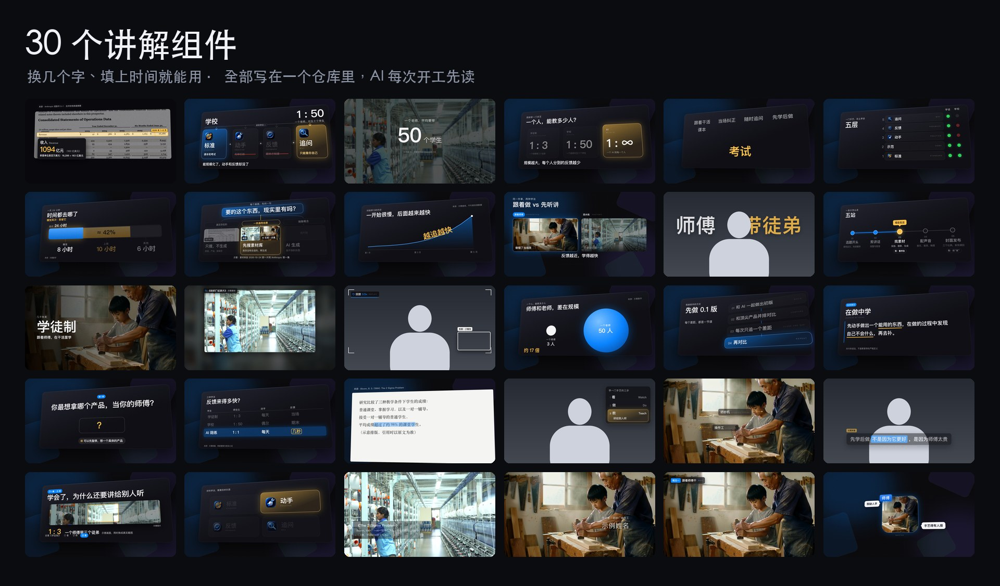

# AI 剪辑工作台

一套写给 AI 读的剪辑系统：用 Claude Code 或 Codex 打开这个文件夹，它就知道该怎么帮你剪口播和讲解视频。



里面是一个人用 AI 做了一个月视频攒下来的东西：
- 13 条剪辑原则；
- 一条片从原片到发布的 10 步工序；
- 30 个讲解画面组件；
- 16 条踩坑记录；
- 5 位头部创作者的拆解。

AI 每次开工先读这些，你就不用每次从头交代。

## 三步用起来

**1. 下载**

点右上角绿色的 **Code → Download ZIP**，解压。会用 Git 的话直接 `git clone`。

**2. 用 AI 打开这个文件夹**

用 [Claude Code](https://claude.com/claude-code) 或 [Codex](https://openai.com/codex) 打开解压后的文件夹。
- Claude Code 第一次要建文件、跑命令时会弹窗问你，点“允许”；
- Codex 先把权限切到“完全访问”，不然它建不了版本记录。

**3. 把下面这段贴给它**

```text
这是一套剪辑系统的仓库。先读 README.md 和 CLAUDE.md，再读 docs/workflow.md 第 0 节。
然后分三轮问我问题，每轮 3–4 个，答完一轮再问下一轮：
① 我做什么视频（平台、片型、横竖屏、时长、现在用什么剪）；
② 我喜欢什么样的剪辑、讨厌什么，我有哪些能讲的真实经历；
③ 我手上有哪些素材和数据，有哪些红线（隐私、预算、必须先问我的事）。
问完以后，把 docs/voice-profile.md、docs/taste.md 和 workflow 第 0 节的默认值改成我的。
跟我说话用大白话，一次只让我做一件事。改完用三句话告诉我改了什么。
```

改完以后，剪一条片只要说：

```text
按 workflow 剪这条：<原片路径>
```

它会先把讲话剪定，再上字幕和讲解画面；关键的地方先出样张给你看，你说可以再往下做。

## 需要准备什么

| 东西 | 必须吗 | 干什么用 |
|---|---|---|
| Claude Code 或 Codex | 必须 | 读规则、干活 |
| [ChatCut](https://chatcut.io) 桌面版 | 推荐 | 工序默认在里面转写、剪辑、合成、导出。用别的剪辑软件也行：规则和组件照样能用，剪辑那几步换成你手动做 |
| Node.js 18+ | 做讲解画面时要 | `cd templates/explainer-kit && npm install`，打开 `gallery.html` 看全部组件 |
| Python 3、ffmpeg | 跑脚本时要 | 打分、找素材、拉数据这些小工具 |
| `.env` 里的 key | 可选 | 复制 `.env.example` 改名为 `.env` 再填。`TIKHUB_API_KEY` 拉抖音等平台的数据，`APIMART_API_KEY` 用来 AI 生图。`.env` 不会被提交 |

## 里面有什么

| 路径 | 是什么 |
|---|---|
| `CLAUDE.md` | 入口规则，AI 每次开工先读。Codex 读 `AGENTS.md`，内容指向同一份 |
| `docs/workflow.md` | 一条片的完整工序；第 0 节写了每一步读什么、你没说时默认怎么做 |
| `docs/viewer-flow.md` | 站在观众这边排内容：开头、顺序、删什么，观众每一刻会不会走 |
| `docs/visual-editing.md` | 每种画面效果解决什么问题、什么时候不用、素材从哪来 |
| `docs/sound.md` | 人声、背景音乐、音效、响度 |
| `docs/video-scorecard.md` | 放行前的检查：字幕区、人脸、字号、节奏 |
| `docs/taste.md`、`docs/voice-profile.md` | 你的口味和你是谁，第一次用时让 AI 问你、改成你的 |
| `docs/lessons/` | 踩坑记录，一条一个文件 |
| `templates/explainer-kit/` | 讲解画面组件库：网页写的组件，渲染成视频或透明叠加层 |
| `research/creators/` | 小Lin说、林超、毕导、何同学、影视飓风的拆解和组件总表 |
| `library/` | 你自己能反复用的素材，配一张索引 |
| `projects/` | 一条片一个目录，开始做片时自动建 |
| `scripts/` | 小工具：成片节奏打分、找素材、拉平台数据、生成只有口播文字的朗读稿 |
| `starter-prompt.md` | 不想用这套、想从空文件夹搭一个自己的剪辑系统，就用这段提示词 |

## 怎么越用越好

系统最值钱的一条规矩：**出了问题，别只修这一处，改系统。** 每次剪出问题，让 AI 找出是缺了哪条规则、哪一步或哪个检查，补上，再记一条踩坑。下一条片就不会再犯。

## 说明

- 规则偏中文平台（抖音、小红书、B 站、X）上的口播和知识讲解类视频，默认横屏。
- 作者自己的项目、素材、账号数据都没有放进来。文档里提到的 `projects/2026-…` 例子你这里看不到，照着规则做就行。
- `docs/dbskill/` 来自 [dontbesilent2025/dbskill](https://github.com/dontbesilent2025/dbskill)，许可是 CC BY-NC 4.0（不可商用），用的时候请保留署名。

## 许可

除 `docs/dbskill/` 以外，都按 [MIT](LICENSE) 开源：随便用、改、商用都行，保留版权声明即可。
